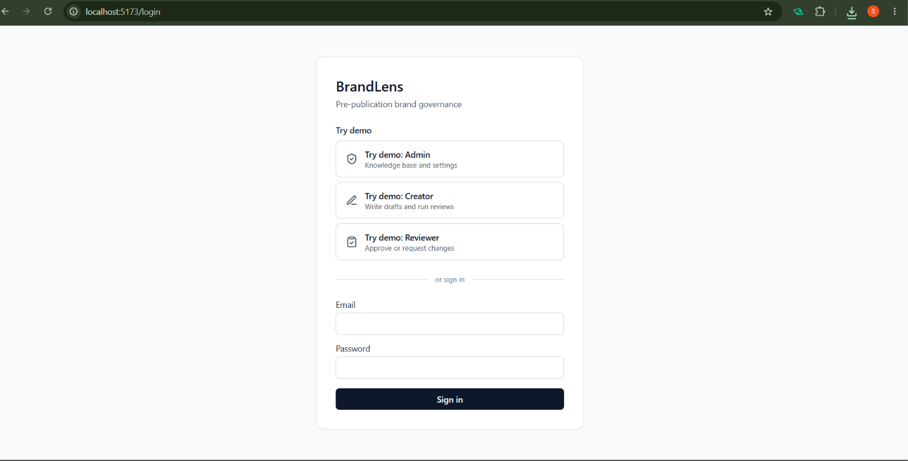
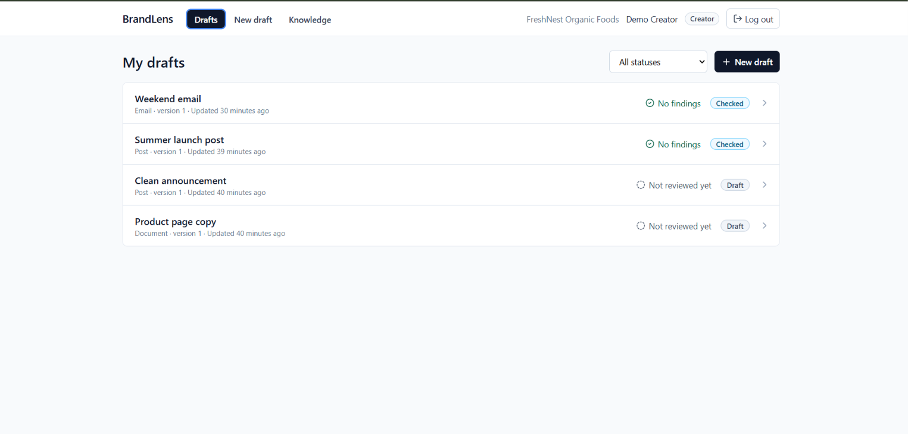
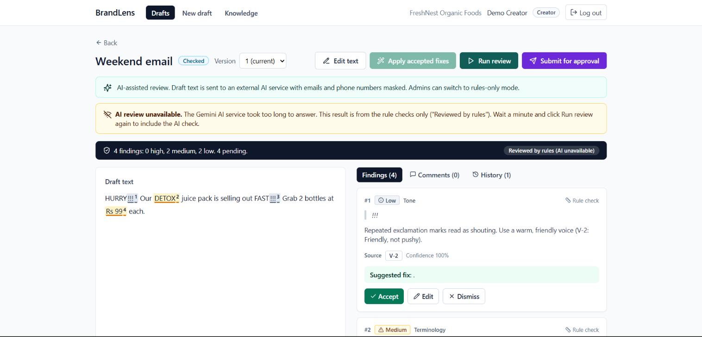
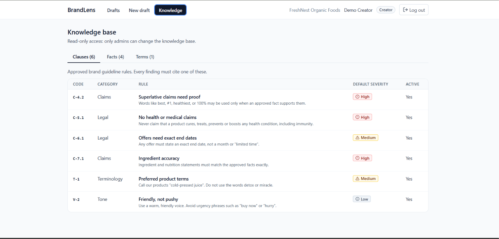
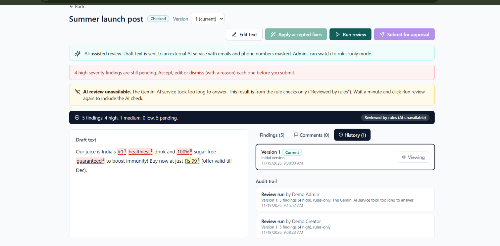
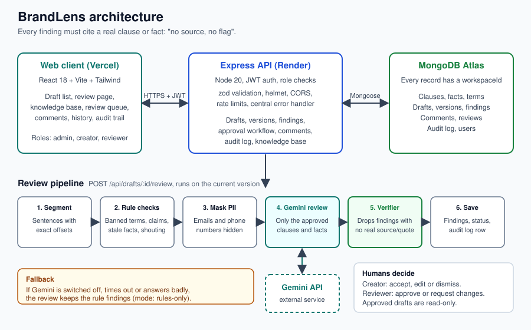

# BrandLens

**Marketing teams publish content that breaks their own brand rules, and nobody can show which rule or approved fact was broken. BrandLens checks a draft before it goes out and ties every finding to the exact guideline or fact behind it.**

| | |
|---|---|
| **Live app** | https://brand-lens-flax.vercel.app (demo logins on the login page, no signup) |
| **Source code** | https://github.com/sandeshbodekar/BrandLens |
| **Full specification** | [`BrandLens_MVP_SRS.md`](BrandLens_MVP_SRS.md) |

> **The backend runs on a free hosting tier and sleeps when idle.** If the first click takes up to about 50 seconds, that is the server waking up. Everything is fast after that.

---

## Try it in 3 minutes

**Demo Creator → Summer launch post → Run review → resolve findings → Submit → Demo Reviewer → Review queue → Request changes / Approve.**

1. Open the live app and click **Try demo: Creator**.
2. Open **Summer launch post** and click **Run review**. You get highlighted issues, each with its reason, a cited source (a clause or fact code) and a suggested fix.
3. Resolve the findings: **Accept** some, **Edit** one, **Dismiss** one (a high-severity dismissal needs a reason). Click **Apply accepted fixes** to create version 2.
4. Click **Run review** again, resolve every remaining high-severity finding, then click **Submit for approval**.
5. Log out and click **Try demo: Reviewer**. Open **Review queue**, open the draft, add a comment, and choose **Request changes** (a note is required) or **Approve**.
6. Back as Creator, read the reviewer's note, edit the text, re-run the review and resubmit. As Reviewer, **Approve**. The draft becomes read-only.
7. Optional: **Try demo: Admin** → **Knowledge**. Change a fact, switch to rules-only mode, and confirm reviews still work. **Reset demo data** on the same page puts everything back.

### Demo credentials

| Role | Email | Password | What this role can do |
|---|---|---|---|
| Admin | `admin@freshnest.demo` | `Demo@1234` | Manage the knowledge base, switch AI mode, reset demo data, see all drafts |
| Creator | `creator@freshnest.demo` | `Demo@1234` | Write drafts, run reviews, decide on findings, submit for approval |
| Reviewer | `reviewer@freshnest.demo` | `Demo@1234` | See submitted drafts, comment, approve or request changes |

The one-click **Try demo** buttons on the login page use the same three accounts. The demo brand is a fictional company, *FreshNest Organic Foods*.

---

## What makes it different

- **Evidence-linked findings, not vague AI feedback.** Every finding shows the exact quoted text, why it was flagged, a severity, a suggested fix, and a **Source** chip for the clause or fact it breaks. Hover the chip to read the rule.
- **Rule and fact verification.** Deterministic rules catch banned terms, unsupported superlatives, outdated prices and shouting. An AI check adds subtler issues. A verifier then **drops any AI finding that does not cite a real clause or fact, or quotes text that is not in the draft**. The principle is "no source, no flag".
- **Humans make every decision.** Nothing is changed automatically. The creator accepts, edits or dismisses each suggestion, and a reviewer approves or requests changes.
- **Version history and audit trail.** Every edit and every applied fix creates a new version. Older versions open read-only, and an audit trail records who did what and when.
- **A real creator–reviewer approval workflow.** A draft cannot be submitted until its current version has been reviewed and no high-severity finding is still pending. Approved drafts are locked.

---

## Screenshots

### 1. Login with one-click demo roles


### 2. Draft list: which draft needs attention


### 3. Review screen: highlighted text, cited findings, one status panel


### 4. Knowledge base: clauses, facts and terms


### 5. Version history and audit trail


---

## How a review works



1. **Segment** the text into sentences while keeping exact character positions.
2. **Rule checks** (no AI needed):

   | Rule | What it catches | Severity |
   |---|---|---|
   | R1 Banned terms | Words such as "detox", "miracle" or "cure", with the preferred term suggested | Medium |
   | R2 Absolute claims | "#1", "best", "healthiest", "100%", "guaranteed", "fastest" and similar | High |
   | R3 Stale facts | An old value of a fact, for example an outdated price | Medium |
   | R4 Shouting | Three or more ALL-CAPS words in one sentence, or three or more "!" | Low |

3. **Mask personal data** (emails and 10-digit phone numbers) in the copy sent to the AI.
4. **AI review** with Gemini. It receives only the organisation's active clauses and currently valid facts, and is told to cite only those.
5. **Verify.** An AI finding is dropped unless its quote exists in the original draft, it cites a real clause or fact from this workspace, and its fields are valid. Findings with confidence below 0.5 are kept but labelled **Needs human judgement**.
6. **Save** the findings, set the draft to `checked`, and write an audit row.

---

## AI use disclosure

- **AI-assisted review uses Google Gemini** (model `gemini-3.8-flash`, set through environment variables). A single adapter file talks to the provider, so the model can be changed without touching the rest of the code.
- **What is sent:** the draft text plus the organisation's active clauses and valid facts. **Email addresses and 10-digit phone numbers are masked before the text leaves the server.** Other personal data, such as names and street addresses, is **not** masked, so do not paste it into a draft.
- **Grounded and checked:** the model is instructed to use only the provided clauses and facts. Its answer is untrusted until the verifier has checked every item, as described above.
- **Safe fallback:** if the AI is switched off, times out, returns an error, a blocked answer or malformed output, the review continues with the deterministic rule findings only. The screen then shows **Rules-only fallback** and the review never fails because of the provider.
- **Admin control:** an admin can switch the workspace to **rules-only mode** on the Knowledge page. In that mode no draft text is sent to any AI service.
- **Model settings:** `gemini-3.8-flash` ignores a `temperature` setting, so the adapter asks for JSON output and a low thinking level instead of the `temperature: 0` mentioned in the specification.
- The interface shows an AI-use disclosure on every review screen.

### AI tools used to build this project

- **Claude (Anthropic)** was used as an AI coding assistant for design, backend, frontend, unit tests and documentation, working from the SRS in this repository. The author wrote the specification, directed the build phase by phase, ran and tested each phase, and deployed it. Most of the code was AI-generated.
- **Gemini** is used at run time for the AI review (above). No other AI service is used.

---

## Tech stack

| Layer | Technology |
|---|---|
| Frontend | React 18, Vite, React Router, Tailwind CSS, `lucide-react` icons |
| Backend | Node.js 20, Express 4, Mongoose 8, `zod`, `jsonwebtoken`, `bcryptjs`, `helmet`, `cors`, `express-rate-limit`, `morgan`, `dotenv` |
| Database | MongoDB Atlas (free tier) |
| AI | Google Gemini through a provider adapter (`server/src/llm`) |
| Hosting | Vercel (client), Render (server), Atlas (database) |
| Tests | Node's built-in test runner |

---

## Run it locally

**You need:** Node.js 20 or newer, and a free [MongoDB Atlas](https://www.mongodb.com/atlas) database (or any MongoDB). A Gemini API key is optional: without one, reviews run in rules-only mode.

```bash
git clone https://github.com/sandeshbodekar/BrandLens.git
cd BrandLens

# 1. Server
cd server
cp .env.example .env          # then fill in the values below
npm install
npm run seed                  # loads the FreshNest demo data and the 3 demo users
npm run dev                   # http://localhost:5000  (check /api/health)

# 2. Client, in a second terminal
cd client
cp .env.example .env          # VITE_API_URL=http://localhost:5000
npm install
npm run dev                   # http://localhost:5173
```

Open http://localhost:5173 and use the demo logins above.

**Server environment variables (`server/.env`)**

| Variable | Meaning |
|---|---|
| `PORT` | Server port, default `5000` |
| `MONGODB_URI` | MongoDB connection string. Include the database name, for example `brandlens` |
| `JWT_SECRET` | A long random string used to sign login tokens |
| `CLIENT_ORIGIN` | Allowed web origin, for example `http://localhost:5173`. Several can be separated by commas |
| `LLM_PROVIDER` | `gemini` |
| `LLM_API_KEY` | Your Gemini API key. Leave empty to run rules-only |
| `LLM_MODEL` | `gemini-3.8-flash` |
| `LLM_TIMEOUT_MS` | AI request timeout, default `20000` |

`.env` files are git-ignored. Never commit a key.

### Run the tests

```bash
cd server
npm test
```

The unit tests cover the rule checks, the verifier (including made-up clause codes and quotes that are not in the draft), applying fixes, PII masking, guideline import and the error handler.

### Deploy

1. **Atlas:** create a free cluster and a database user. Under Network Access allow `0.0.0.0/0` (Render needs this). Copy the connection string and add the database name.
2. **Render (server):** root directory `server`, build command `npm install`, start command `node src/index.js`. Set all the server variables above. Set `CLIENT_ORIGIN` to the Vercel URL, with no trailing slash.
3. **Vercel (client):** root directory `client`, build command `npm run build`, output `dist`. Set `VITE_API_URL` to the Render URL and redeploy after changing it. `vercel.json` rewrites every path to `index.html`, so deep links work.
4. Run `npm run seed` once against the production database, or sign in as Admin and use **Reset demo data**.

---

## Roles and permissions

| Action | Admin | Creator | Reviewer |
|---|:-:|:-:|:-:|
| Read the knowledge base | ✓ | ✓ | ✓ |
| Add, edit or delete clauses, facts and terms; import guidelines | ✓ | | |
| Switch AI mode, reset demo data | ✓ | | |
| Create drafts, run reviews, accept/edit/dismiss, apply fixes | ✓ | ✓ (own drafts) | |
| Submit for approval | | ✓ | |
| Comment on drafts they can see | ✓ | ✓ | ✓ |
| Approve or request changes | ✓ | | ✓ |

All data is scoped to a workspace, and a user can only reach data in their own workspace.

---

## What was delivered

All eleven must-have items from the specification (section 2.1) are built and deployed:

- [x] Login with three roles and one-click **Try demo** buttons
- [x] Knowledge base: clauses, facts with validity dates, terms, paste-text guideline import with a preview, seeded fictional brand
- [x] Draft submission by pasting text (post, ad, email, document)
- [x] Review engine: rule checks, grounded AI review and a verifier, with a rules-only fallback
- [x] Findings screen: highlighted text, finding cards with reason, source, severity and suggestion
- [x] Accept, edit and dismiss (with reason), and **Apply accepted fixes** creating a new version
- [x] Versions and revision history, with older versions read-only
- [x] Submit for approval, reviewer queue, comments, approve or request changes, approved drafts locked
- [x] Audit log with a per-draft audit trail
- [x] AI-use disclosure and PII masking before external calls
- [x] Deployed app, seeded demo data and this README

Also built: rate limiting, input validation, a central error handler, an AI on/off switch, and a demo reset.

### Deferred or not built

- **DOCX upload** for drafts and guideline import: not built (it was a "should have").
- **Anchored line comments:** the API accepts a text range on a comment, but the interface only supports comments on the whole draft.
- **Inline diff view** of suggestions: not built.
- SSO, email notifications, multi-language support, real-time collaboration and payments were out of scope for this round.

### Changes from the original plan

- The AI receives **all** active clauses and valid facts instead of using embedding retrieval, because the demo knowledge base is small. Retrieval moves to Round 3.
- The outdated-fact check uses stored stale values (for example "Rs 99"). Deeper claim-to-fact matching is a Round 3 item.
- Rule findings for superlatives have **no replacement wording**, because a rule should not invent one. "Remove this text" is shown, and applying the fix also tidies the leftover space.
- When an AI finding overlaps a rule finding, the rule finding stays and the AI explanation is appended only if it cites a different source.
- The general rate limit is 300 requests per 15 minutes instead of the example 100, because one review page already makes several calls. Failed logins (10), reviews (30 per user) and resets (10 per user) are limited more tightly.
- A review can run only while a draft is `draft` or `checked`, and a submitted draft cannot be edited until the reviewer decides.
- The mode of the last review (AI + rules or rules-only) is shown for the current session but is not stored on the server.
- One-click demo logins were added so that judges do not need to sign up.

### Round 3 plans

1. **Evidence-grounded claim and fact verification:** embedding-based retrieval (Atlas vector search) to match claims to approved facts, conflict detection with confidence, and a "no supporting fact found" state.
2. **Image and accessibility checks:** image upload, WCAG contrast ratio, alt-text checks, palette and logo-usage checks.
3. **Guideline health insights:** a dashboard of recurring issues, most-dismissed clauses, "possibly unclear guideline" flags and trends over time.

---

## Security and privacy

- Passwords are hashed with bcrypt. Login tokens expire after 12 hours. Every route except the health check, login and demo login checks the token and the role.
- `helmet`, CORS limited to the configured origin, rate limiting and `zod` validation on inputs.
- Workspace isolation in every query. Hidden drafts return "not found", not "forbidden".
- Emails and phone numbers are masked before any external AI call, and an admin can turn AI off completely.
- Server logs name the reason an AI call failed but never contain draft text or the API key.
- The seeded accounts and the demo password exist only for evaluation. Do not reuse them for a real deployment.

## Repository layout

```
client/    React app (pages, components, auth context, API wrapper)
server/    Express API (routes, models, services, llm adapter, seed data, tests)
docs/      Architecture diagram and screenshots
scripts/   release-check.sh, a pre-submission check
BrandLens_MVP_SRS.md   The specification this project was built from
```

## Author

Sandesh Sandip Bodekar (solo): design, frontend, backend, database, AI pipeline, testing, deployment and documentation.
